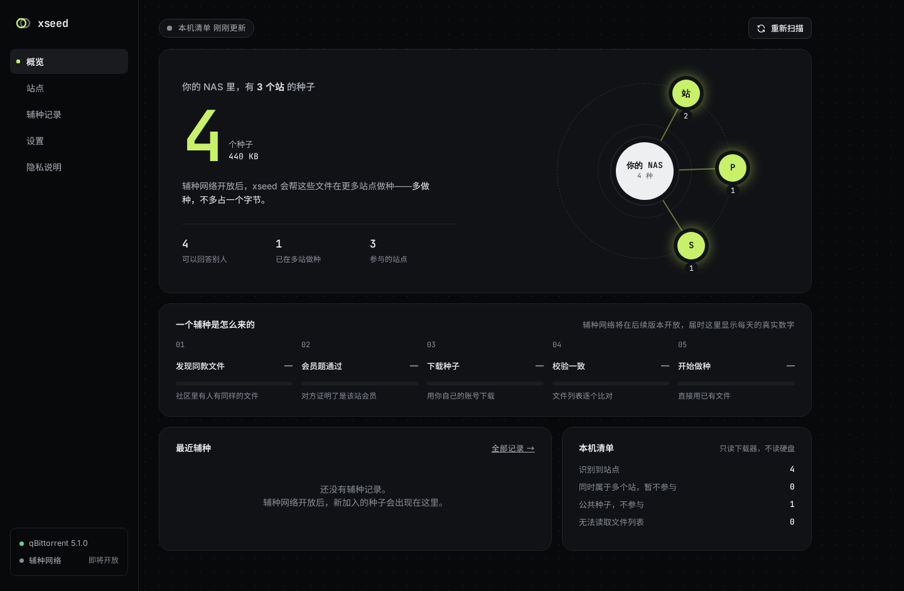

# xseed

去中心化的 PT 辅种小助手。装在你的 NAS 或电脑上，连接本机的 qBittorrent / Transmission，自动帮你找到“同样的文件在其他站也有”的种子并加入下载器做种。

- **服务器什么都不知道**：社区节点只登记不透明的文件指纹并转发加密消息，没有任何站点资源目录。
- **只对同站会员透露**：别人必须答对一道只有该站会员才能答上的题，才能得知你在该站的种子编号；他用自己的账号去站点下载种子。
- **IP 不暴露给其他用户**：所有消息都经节点转发。
- **不动你的文件**：新种子直接指向已有文件，跳过校验；不复制、不移动、不删除。
- **小白可用**：只需填写下载器，站点自动识别；可从 PT-depiler 经 WebDAV 同步各站 Cookie。

> **当前进度：M3「会员答题」**——小助手能连接下载器、识别站点、从 PT-depiler 同步凭证；连上社区节点后，匿名登记文件指纹、找出有同款文件的人，并通过“会员答题”向对方证明自己是某站会员，拿到该站的种子编号。自动下载与加种（M4）尚未开放，见[开发计划](docs/04-开发计划.md)。



## 运行

### Docker

```sh
docker run -d --name xseed --network host \
  -v /path/to/xseed:/data \
  ghcr.io/aidever/xseed:main
```

然后在浏览器打开 `http://<NAS 地址>:7731`，按向导设置管理员密码、填写下载器地址。

- 推荐 `--network host`：这样小助手可以用 `http://localhost:8080` 访问同一台机器上的下载器。用桥接网络时，请在向导中填写下载器的局域网地址，并加 `-p 7731:7731`。
- 小助手**不需要**映射你的数据目录，只通过下载器的网页接口工作。

### 从源码

```sh
cargo build --release
XSEED_DATA=./data ./target/release/xseed-agent
```

| 环境变量 | 默认值 | 说明 |
|---|---|---|
| `XSEED_DATA` | `data` | 数据目录：配置 `xseed-agent.toml`、数据库、加密密钥 `vault.key` |
| `XSEED_LISTEN` | `0.0.0.0:7731` | Web UI 监听地址（覆盖配置文件） |
| `XSEED_REGISTRY` | 空 | 社区节点清单（http(s) 地址或文件）；也可在“设置”页填写。官方清单在正式发布时内置 |

忘记管理员密码：在小助手所在设备上运行 `xseed-agent reset-password`（Docker 中为 `docker exec xseed xseed-agent reset-password`），然后重新打开页面设置新密码。

### 运行社区节点

```sh
XSEED_NODE_DATA=./node-data ./target/release/xseed-node manifest https://node.example.org   # 打印清单条目
XSEED_NODE_DATA=./node-data XSEED_NODE_REGISTRY=https://…/registry.json ./target/release/xseed-node
```

节点默认监听 `0.0.0.0:7800`（明文 HTTP），请在前面放 Caddy / Nginx 终止 TLS，并在 `xseed-node.toml` 中开启 `trust_proxy`。1 核 1 GB 可服务约 1 万个在线小助手。Docker：`docker run --entrypoint xseed-node -v …:/data -p 7800:7800 ghcr.io/aidever/xseed:main`。

## 代码结构

| 目录 | 说明 |
|---|---|
| `crates/xseed-core` | 与网络无关的算法：bencode、种子解析与文件列表规范化、文件指纹、桶、HRW、工作量证明、站点识别 |
| `crates/xseed-transport` | 社区节点协议：消息格式（CBOR）、HPKE 两跳封装、代号、信箱鉴权与节点签名、探测标签、节点清单、小助手侧客户端 |
| `crates/xseed-node` | 社区节点：信箱长连接、代号签发、桶索引、两跳网关、节点间转发、限流、快照 |
| `crates/xseed-agent` | 小助手：辅种网络（入口节点、登记、查询、探测）、下载器适配（qBittorrent / Transmission）、清单扫描、凭证加密、PT-depiler WebDAV 接收端、Web API |
| `crates/xseed-agent/web` | Web UI（原生 JS，无构建步骤，编译时嵌入二进制） |

## 文档

| 文档 | 说明 |
|---|---|
| [征求意见稿](docs/proposal/去中心化辅种-征求意见稿.md) | 面向社区的简要说明（早期版本，尚未同步设计 2.0） |
| [概要设计说明书](docs/02-概要设计说明书.md) | 需求基线、总体结构、产品形态、接口、关键流程、设计决策 |
| [详细设计说明书](docs/03-详细设计说明书.md) | 算法、协议、数据结构、配置、界面、安全、性能、错误码 |
| [落地设计（决策记录）](docs/00-落地设计.md) | 讨论阶段的决策记录，与 02/03 冲突时以 02/03 为准 |
| [页面设计稿 v3「星轨」](docs/ui/README.md) | 小助手 Web UI 设计规范与画布源文件 |
| [开发计划](docs/04-开发计划.md) | 里程碑与进度 |

## 反馈

请在 [Issues](https://github.com/aidever/xseed/issues) 中提出。
