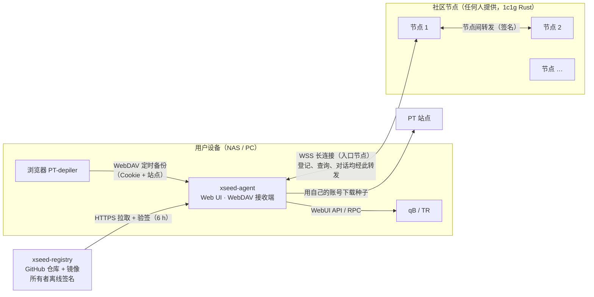
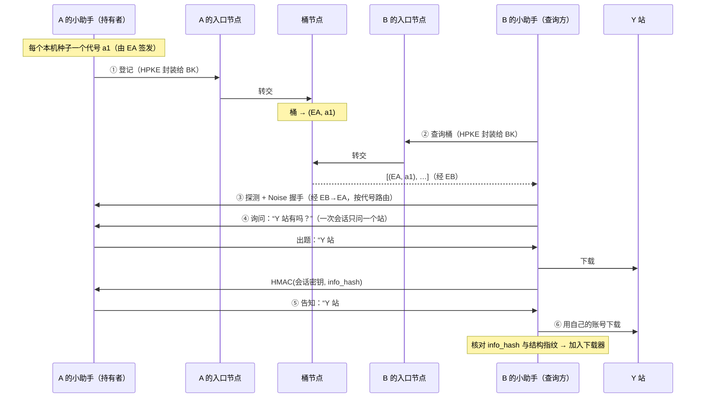

# xseed 去中心化辅种 概要设计说明书

| 项 | 内容 |
|---|---|
| 文档编号 | XSP-HLD |
| 版本 | 2.0 |
| 状态 | 草案 |
| 作者 | xseed |
| 日期 | 2026-11-08 |
| 关联文档 | [落地设计（决策记录）](00-落地设计.md)、[详细设计](03-详细设计说明书.md)、[征求意见稿](proposal/去中心化辅种-征求意见稿.md)、[页面设计稿](ui/index.html) |

修订记录：

| 版本 | 日期 | 说明 |
|---|---|---|
| 1.0 | 2026-11-07 | 初稿：三道锁、验证后直连、对端发送清洗后的种子 |
| 2.0 | 2026-11-08 | 整体简化。对端只告知“站点 + 种子编号”，查询方用自己的账号从站点下载种子，取消种子清洗与种子传输；会员验证统一为“答题”；取消打洞直连与 Tor，消息全程经节点转发，IP 永不暴露给对端；取消持有证明（锁 2）与 scrape 挑战；登记按“每个本机种子一个一次性代号”，防止拼凑身份；新增小白可用的产品形态（自动识别站点、从 PT-depiler 经 WebDAV 同步站点凭证、无需挂载数据目录） |

> xseed 是独立工具，不依赖任何特定的站点框架。需求、决策、错误码前缀统一为 `XSP`（xseed P2P）。本文与 00-落地设计有冲突时，以本文为准。

---

## 1. 设计目标与原则

### 1.1 需求基线

本组件没有单独的需求规格说明书，下表即需求基线，供 §9 追溯。

| 编号 | 需求 | 优先级 |
|---|---|---|
| FR-XSP-001 | 读取本机下载器（qBittorrent、Transmission）中已完成的种子，计算结构指纹 | P0 |
| FR-XSP-002 | 辅种判定：去掉填充文件和根目录名后，文件列表（规范化相对路径、大小、顺序）完全一致；单文件种子还要求文件名一致 | P0 |
| FR-XSP-003 | 发现同样持有该内容的其他设备；任何一方（包括节点）都不持有“哪个站有哪些资源”的目录 | P0 |
| FR-XSP-004 | 设备之间的消息端到端加密，节点不能读取或篡改 | P0 |
| FR-XSP-005 | 只有答对会员题（证明是该站会员）的对端，才能得知本机在该站的种子编号；非会员拿不到任何站点资源信息 | P0 |
| FR-XSP-006 | 会员题不能被中间人转手给他人代答（通道绑定） | P0 |
| FR-XSP-007 | 任何对端都拿不到本机 IP；单个节点不能同时得知“某 IP”与“某指纹” | P0 |
| FR-XSP-008 | 对端无法把同一个人的多次回答关联起来（不同种子、不同站点使用互不关联的代号） | P0 |
| FR-XSP-009 | 查询方用自己的账号从站点下载种子，核对 info_hash 与结构指纹后加入下载器；信任本机下载器状态，跳过校验 | P0 |
| FR-XSP-010 | 下载器操作安全：不删数据、不移动数据、只操作自己加入的种子、幂等；不要求小助手能访问数据目录 | P0 |
| FR-XSP-011 | 站点识别：站点定义库（首版从 PT-depiler 导入）+ 按 tracker 主机匹配，支持多 tracker | P0 |
| FR-XSP-012 | 站点凭证自动获取：PT-depiler 经 WebDAV 备份同步 Cookie；从 tracker 地址提取 passkey；手动填写兜底 | P0 |
| FR-XSP-013 | 节点由任何人提供，经注册中心登记；按桶水平扩展；节点之间不同步数据 | P0 |
| FR-XSP-014 | 注册中心内容由所有者离线签名，客户端定时拉取并验签；包含站点对 P2P 辅种的态度与是否允许跳过校验 | P0 |
| FR-XSP-015 | 小白可用：安装后只需填写下载器，站点自动识别；全自动运行；错误提示给出下一步操作 | P0 |
| FR-XSP-016 | 防滥用：登记与查询限流和工作量证明；每站每天加种与答题上限 | P0 |
| FR-XSP-017 | 首次试运行、Web UI、审计日志；一键移除本软件加入的全部种子（保留文件） | P1 |
| FR-XSP-018 | 站点可选发布 P2P 辅种策略声明（任何站点框架都可实现） | P1 |
| NFR-XSP-001 | 单节点 1 vCPU / 1 GiB 内存：≥ 1 万条长连接，且 ≥ 1500 万条桶登记；整体容量随节点数线性增长 | P0 |
| NFR-XSP-002 | 一次辅种交换经每个节点转发的流量 ≤ 8 KiB | P0 |
| NFR-XSP-003 | 小助手空闲时内存 < 60 MiB；支持 amd64 / arm64；提供 Docker 镜像与 Windows 托盘程序 | P1 |
| NFR-XSP-004 | 默认读盘量为 0（指纹来自下载器提供的种子元数据，不读数据文件） | P0 |
| NFR-XSP-005 | 节点、注册中心可在 24 小时内整体迁移（节点全部为软状态） | P0 |

### 1.2 设计原则

1. **服务器什么都不知道。** 节点只保存“桶号 → 不透明代号”，没有站点、种子编号、IP 的任何对应关系。站点资源信息只存在持有者本机，验证通过后才告诉对方。
2. **先验证、后透露。** 种子编号只发给答对会员题的对端；IP 不发给任何对端。
3. **零信任节点。** 节点作恶最多造成拒绝服务；机密性和完整性由端到端密码学保证。
4. **软状态。** 节点上的全部状态都可以丢失，由客户端周期性重建；节点之间不复制数据。
5. **本机为准。** 加种前以本机下载器状态和本机下载到的种子为准，不信任对端的声明。
6. **失败安全。** 任何一步不确定就放弃这一条，不改动已有种子和文件。
7. **对用户隐藏概念。** 指纹、节点、代号、答题全部在后台完成，界面只呈现“下载器、站点、辅种结果”。

### 1.3 非目标

部分辅种；保护 BT 数据传输本身的匿名性（做种时 tracker 和 BT 对端本来就能看到 IP）；对节点运营者隐藏“某 IP 在使用本软件”；Deluge / rTorrent 适配（v2）；Tor / I2P；站点群组密钥（v2，见 §8）。

---

## 2. 总体结构

### 2.1 部署视图



| 组件 | 部署者 | 形态 | 状态 |
|---|---|---|---|
| `xseed-agent` | 用户 | Rust 单文件二进制：Docker 镜像（amd64 / arm64，适配群晖、Unraid、飞牛等）、Windows 托盘程序；内置 Web UI 与 WebDAV 接收端 | SQLite（凭证加密） |
| `xseed-node` | 任何人 | Rust 单文件二进制；每个节点同时承担“入口”（长连接、转发）与“桶”（登记、查询）两种职责 | 内存软状态；优雅退出时可选快照 |
| `xseed-node-cf` | 项目官方（P2） | workers-rs 包装 `xseed-core`，Worker + Durable Objects | 同上 |
| `xseed-registry` | 所有者 | GitHub 仓库 + 发布 CLI | Git |
| 站点策略声明（可选） | 站长 | 任何站点框架实现 `/.well-known/pt-xseed` 静态 JSON | 无 |

### 2.2 Cargo workspace 与 crate 划分

| crate | 类型 | 职责 | 依赖要点 |
|---|---|---|---|
| `xseed-core` | lib，可编译到 `wasm32` | 指纹与桶、HRW、CBOR 消息、工作量证明、代号编解码、注册中心索引解析与验签、限流算法 | `sha2`、`hkdf`、`hmac`、`aes`、`ciborium`、`minisign-verify`、`unicode-normalization` |
| `xseed-session` | lib，sans-IO | Noise 握手、会话状态机（询问 → 答题 → 告知）、通道绑定 | `snow`（`Noise_XXpsk3_25519_ChaChaPoly_BLAKE2s`） |
| `xseed-transport` | lib | 入口节点 WebSocket 客户端、HPKE 两跳封装 | `tokio-tungstenite`、`hpke`、`rustls` |
| `xseed-node` | bin | HTTP / WS 服务、入口、转发、桶索引、网关 | `axum`、`tokio`、`ed25519-dalek` |
| `xseed-agent` | bin | 下载器适配、站点客户端、PT-depiler 同步、任务调度、本地库、Web UI、托盘 | `sqlx`（sqlite）、`reqwest`、`keyring`、`axum`、`zip`、`tray-icon`（Windows）；WebDAV 只实现最小子集 |
| `xseed-registry` | bin | PT-depiler 导入、清单校验、索引生成、离线签名、CI 健康检查 | `minisign` |

### 2.3 agent 内部模块

| 模块 | 职责 |
|---|---|
| `inventory` | 周期性从下载器读取完成的种子与文件列表；计算指纹；识别站点；解析本机种子编号 |
| `credentials` | 汇总站点凭证：PT-depiler 同步、tracker passkey 提取、手动填写；加密存储 |
| `ptd_sync` | WebDAV 接收端；解析 PT-depiler 备份（Cookie、站点列表） |
| `registry_sync` | 拉取并验签注册中心索引 |
| `nodes` | 选择入口节点、维护长连接、申领代号、两跳登记与查询 |
| `responder` | 处理入站探测；作为持有者运行会话；出题、判题、告知 |
| `requester` | 对本机种子发起查询；作为查询方运行会话；答题 |
| `challenge` | 维护本机题库（出题用）与答题缓存（答题用） |
| `jobs` | 加种任务状态机：下载种子 → 核对 → 加入 → 启动 → 观察 |
| `downloader` | qB / TR 适配器（trait `Downloader`） |
| `sites` | 站点识别、下载地址推导、按站限速与配额、站点特性学习 |
| `vault` | 凭证加密存储 |
| `webui` | 首次向导、管理界面、JSON API |

### 2.4 node 内部模块

| 模块 | 职责 |
|---|---|
| `mailbox` | 创建信箱（工作量证明）、WSS 鉴权、投递；不在线即拒收，不暂存 |
| `alias` | 签发与解析代号（无状态，节点密钥加密） |
| `relay` | 节点间转发 `/v1/fwd` |
| `gateway` | 两跳请求的入口转发与出口解封装（OHTTP 式） |
| `index` | 桶登记、查询、过期 |
| `limits` | 令牌桶、工作量证明难度、按信箱与来源节点限流 |
| `health` | `/.well-known/xseed`、负载报告、指标 |

---

## 3. 产品形态与使用流程

### 3.1 用户操作（三步）

| 步骤 | 用户做什么 | 后台发生什么 |
|---|---|---|
| ① 安装 | NAS：应用商店或一行 `docker run`；Windows：运行安装包，常驻托盘 | 生成数据目录；首次打开强制设置管理员密码 |
| ② 填下载器 | 选择 qB / TR，填地址、用户名、密码，点“测试连接” | 读取做种列表，计算指纹，识别站点，提取 passkey |
| ③ 确认站点 | 在自动识别出的站点列表中勾选，点“开始” | 首次试运行，展示“能辅多少、辅到哪些站”；确认后转为全自动 |

可选：在 PT-depiler 中添加小助手提供的 WebDAV 地址，自动同步 Cookie（§3.3）。

### 3.2 站点列表状态

| 状态 | 含义 | 默认 |
|---|---|---|
| 可直接用 | 已有可用凭证（passkey 或 Cookie），站点未表态反对 | 勾选 |
| 需要 Cookie | 该站下载种子必须 Cookie，未取得 | 不勾选，提示“从 PT-depiler 同步”或手动填写 |
| 站长不允许 | 注册中心标记 `p2p: deny` | 不勾选，且不可勾选 |
| 未表态 | 注册中心标记 `p2p: unknown` | 勾选，旁注“站点未表态” |
| 禁止跳过校验 | 注册中心标记 `allow_skip_check: false` | 勾选；该站加种后由下载器校验 |

### 3.3 从 PT-depiler 同步站点凭证

PT-depiler 的备份功能支持 WebDAV 目标与定时自动备份，备份内容可勾选 Cookie 与元数据（站点列表、站点与域名的映射）。小助手内置一个最小的 WebDAV 接收端：

1. 小助手界面给出 WebDAV 地址、用户名、随机密码（一键复制），并建议设置加密密钥。
2. 用户在 PT-depiler “设置 → 备份”中添加该 WebDAV，勾选“Cookie”“元数据”，设置自动备份间隔。
3. PT-depiler 每次备份上传 `PTD_backup_*.zip`；小助手解析后只提取 Cookie 与站点列表，加密存入本机，其余内容不读取、不保存。

站点 ID 与 PT-depiler 一致（站点库就是从它导入的），识别无歧义；Cookie 随自动备份持续刷新。

### 3.4 凭证优先级

PT-depiler 同步的 Cookie > tracker 地址中提取的 passkey > 用户手动填写。任何凭证只在本机使用，不出现在任何对外消息中。

### 3.5 不需要访问数据目录

小助手只通过下载器 API 工作：指纹来自下载器提供的种子元数据；加种时让新种子指向原种子的文件：qB 把保存位置设为原目录并使用“无子文件夹”布局，TR 加入后用重命名接口把根目录名改成原名。因此 Docker 部署不需要挂载数据目录，也不存在路径映射问题。配置了数据目录映射时，可额外开启“首尾分块抽查”。

---

## 4. 对外接口清单

### 4.1 节点 HTTP / WebSocket 接口

| 方法 | 路径 | 调用方 | 说明 |
|---|---|---|---|
| GET | `/.well-known/xseed` | agent、CI、节点 | 协议版本、节点 ID、负载、时间、工作量证明盐 |
| POST | `/v1/mailbox` | agent | 创建信箱（附工作量证明） |
| GET | `/v1/mailbox/ws` | agent | WebSocket 长连接：收发信封 |
| POST | `/v1/aliases` | agent | 为本信箱申领一批代号 |
| POST | `/v1/ohttp` | agent | 两跳请求入口：把 HPKE 封装的请求转给目标桶节点 |
| POST | `/v1/gateway` | 节点 | 两跳请求出口：解封装后执行登记或查询 |
| POST | `/v1/fwd` | 节点 | 节点间信封投递（节点签名），按代号路由到信箱 |

### 4.2 agent 依赖的外部接口

| 对象 | 接口 | 用途 |
|---|---|---|
| qBittorrent | WebUI API v2：`auth/login`、`torrents/info`、`torrents/files`、`torrents/export`、`torrents/properties`、`torrents/trackers`、`torrents/add`、`torrents/start`（4.x 为 `resume`）、`torrents/delete` | 清单、加种、启动、移除 |
| Transmission | RPC：`torrent-get`、`torrent-add`、`torrent-rename-path`、`torrent-start`、`torrent-remove` | 同上 |
| PT 站点 | 种子下载地址（按站点定义或框架推导） | 下载目标种子、下载题库种子、答题 |
| PT-depiler | WebDAV 客户端（由 PT-depiler 主动上传） | 同步 Cookie 与站点列表 |
| 愿意配合的站点 | `GET /.well-known/pt-xseed` | 站点策略 |
| 注册中心镜像 | `index.cbor`、`index.cbor.minisig` | 节点、站点、站点特性 |

### 4.3 agent 本地接口

| 接口 | 说明 |
|---|---|
| Web UI / JSON API `http://<设备>:7731` | 首次向导、概览、站点、任务、日志、设置；必须登录 |
| WebDAV `http://<设备>:7731/ptd/` | PT-depiler 备份接收端；独立的随机用户名密码 |
| CLI `xseed-agent` | `run`、`dry-run`、`remove-all`、`vault set` |
| Prometheus `/metrics`（可选） | 指标 |

### 4.4 站点侧可选接口

| 方法 | 路径 | 鉴权 | 说明 |
|---|---|---|---|
| GET | `/.well-known/pt-xseed` | 无 | 站点策略：是否允许 P2P 辅种、tracker 主机、下载模板、是否允许跳过校验 |

### 4.5 定时任务（agent）

| 任务 | 周期 | 说明 |
|---|---|---|
| `inventory.scan` | 10 min，下载器事件触发时立即 | 增量扫描完成的种子 |
| `registry.sync` | 6 h | 拉取注册中心索引 |
| `index.refresh` | 24 h，分散在全天随机时刻小批量发送 | 刷新桶登记 |
| `requester.query_new` | 新种子入清单后 5–30 min 内随机 | 查询新增内容 |
| `requester.query_all` | 每 7 天轮询一遍全部本机种子 | 发现新出现的持有者 |
| `challenge.refill` | 每站每周最多 4 次 | 补充题库 |
| `jobs.observe` | 1 min | 观察新加入种子的状态 |

### 4.6 定时任务（node）

| 任务 | 周期 | 说明 |
|---|---|---|
| `index.expire` | 1 min | 清理过期登记 |
| `mailbox.gc` | 10 min | 回收 7 天未连接的信箱槽位 |
| `limits.decay` | 1 s | 令牌桶补充 |

---

## 5. 数据设计概要

| 实体 | 所在位置 | 生命周期 | 说明 |
|---|---|---|---|
| 本地清单 `local_torrents` | agent SQLite | 跟随下载器 | 指纹、站点、种子编号、tracker 主机 |
| 代号 `aliases` | agent SQLite | 每周轮换 | 每个本机种子一个代号，以及代号所属的入口节点 |
| 题库 `challenge_pool` | agent SQLite | 每题最多使用 50 次或 30 天 | 出题用：站点、种子编号、info_hash |
| 答题缓存 `answer_cache` | agent SQLite | 90 天 | 答题用：站点、种子编号 → info_hash，避免重复下载 |
| 报价 `offers` | agent SQLite | 90 天 | 对端告知的“内容 × 站点 × 种子编号” |
| 加种任务 `jobs` / 本软件加入的种子 `added_torrents` | agent SQLite | 永久（审计） | 状态机与移除白名单 |
| 站点状态 `sites` / 站点特性 `site_traits` | agent SQLite | 用户管理 / 30 天 | 开关、配额、学到的下载模板 |
| 凭证 `credentials` | agent SQLite（加密）+ 系统密钥环 | 用户管理 | passkey、Cookie，标注来源 |
| 信箱 | node 内存 | 7 天不连接即回收 | 槽位、密钥 hash、连接 |
| 桶登记 | node 内存 | 3 天 TTL | 桶 → [（入口节点，代号）] |
| 注册中心索引 | GitHub + 镜像；agent 本地缓存 | 版本单调递增 | 节点、站点、站点特性 |

---

## 6. 关键流程

### 6.1 全景时序



### 6.2 登记（两跳）

```
agent A                 入口节点 EA                     桶节点 BK（HRW 选出，R=2）
  │ 为每个本机种子取一个代号（/v1/aliases 预先申领）
  │ 按 HRW 把（桶, 代号）分组；每批 ≤ 64 条，打乱顺序，分散在全天发送
  │ req = HPKE.Seal(pk_BK, REGISTER{entries, pow})
  │── POST /v1/ohttp {target=BK, req} ─►│
  │                                     │── POST /v1/gateway {req} ─►│ 解封装、校验 pow、写入
  │◄──────────── 响应（HPKE 封装）──────│◄────────────────────────────│
```

EA 知道 A 的 IP，看不到桶；BK 看得到桶，只看到 EA 的 IP。BK 恰好是 EA 自己时，改由另一个入口节点转发。

### 6.3 会话

```
Init ─PROBE→ Probing ─ACK→ Handshaking ─(3 条 Noise 消息)→ Asking
Asking ─ASK{site}→
   持有者不是该站会员 → NOT_MEMBER → Closed
   持有者是该站会员 → CHAL{torrent_id} → Answering ─ANSWER{mac}→
        答错 → Closed(bad_answer)
        答对，且该代号对应的种子属于该站 → OFFER{torrent_id, info_hash, size} → Done
        答对，但不属于该站 → NONE → Done
```

持有者对“是会员但没有”和“是会员且有”都先出题，非会员无法通过询问判断资源在哪个站。

### 6.4 加种任务

```
offer ─► 按站点模板下载种子（自己的账号；每站限速）
      ─► 核对：info_hash == 告知值，结构指纹 == 本机
      ─► 加入下载器：停止状态、跳过校验（站点禁止则不跳过）、保存位置 = 原种子保存位置、tag=xseed
      ─► 根目录名不同 → qB 用“无子文件夹”布局指向原目录；TR 重命名根目录
      ─► 检查状态（文件缺失 / 错误 → 移除，不删文件）
      ─► 随机延迟 0–10 min 启动 ─► 观察 tracker（unregistered → 移除）
      ─► 做种中
```

### 6.5 注册中心发布

```
所有者本机：编辑 nodes/ sites/ traits/ ─► xseed-registry publish
  ├─ 校验清单 schema、节点 /.well-known 签名挑战
  ├─ 生成 index.cbor（version = 上一版 + 1）
  ├─ minisign 签名（私钥只在本机）
  └─ git push ─► Actions 同步到 Releases / Pages / jsDelivr
agent：拉取 ─► 验签（内置主、备公钥）─► version 必须递增 ─► 原子替换
```

---

## 7. 设计决策

| 编号 | 问题 | 备选方案 | 结论 | 理由 |
|---|---|---|---|---|
| DD-XSP-1 | 怎么发现持有者 | ① 中心目录（IYUU 式）② 全量索引分发 ③ BitTorrent DHT ④ 节点上的分桶登记 | ④ | ① 服务器持有全站资源目录，被攻破或运营者作恶即全量泄露；② 站长不会接受；③ 谁在登记谁在查询对全网公开，IP 直接暴露；④ 节点只见桶号与不透明代号 |
| DD-XSP-2 | 桶怎么分到节点 | 一致性哈希环、HRW | 加权 HRW，R=2 | 不需要虚拟节点；增删节点平均只移动 1/N；权重对应节点容量 |
| DD-XSP-3 | 防止 IP 与指纹被同一节点关联 | 直连桶节点、Tor、两跳 | HPKE 两跳（OHTTP 式） | 需要入口节点与桶节点合谋才能关联；无需额外基础设施；国内可用 |
| DD-XSP-4 | 会话加密 | TLS、Noise IK、Noise XXpsk3 | Noise XXpsk3，临时静态密钥 | 没有长期身份，会话之间不可关联；psk 由指纹派生，不知道指纹的人无法完成握手 |
| DD-XSP-5 | 怎么证明对端是该站会员 | ① 相信声明 ② 持有证明 + scrape / 下载挑战 ③ 站点群组密钥 ④ 答题（下载一个种子算 info_hash） | ④；③ 留到 v2 | ① 可被批量刷出全站目录；② 复杂，scrape 支持参差；③ 需要站点装插件，起步阶段覆盖不到；④ 所有站通用，非会员答不出 |
| DD-XSP-6 | 防答题被中间人转手 | 无、通道绑定 | 答案 = HMAC(会话握手 hash 派生的密钥, info_hash) | 中间人两侧握手 hash 不同，他人代答的结果无法转用 |
| DD-XSP-7 | 题目从哪里来 | 持有者本机的其他种子、站点随机种子 | 站点近期编号中随机挑、与本机无关 | 本机种子会暴露持有者做种列表，可与站点同伴列表求交集定位身份 |
| DD-XSP-8 | 对端告知什么 | 清洗后的原版种子、站点 + 种子编号 | 站点 + 种子编号 + info_hash | 不存在凭证或水印泄露；下载本身再次证明会员身份；没有种子传输，节点流量极小 |
| DD-XSP-9 | 是否直连 | 验证后直连、始终经节点 | 始终经节点 | 只交换几 KiB 消息；IP 永不暴露给对端；省去打洞与证书钉扎 |
| DD-XSP-10 | 防拼凑身份 | 每设备一个信箱地址、每种子一个代号 | 每个本机种子一个代号，按周轮换；一次会话只问一个站 | 对端无法把同一人的多次回答关联起来，无法用同伴列表求交集，也无法关联同一人在多个站的身份 |
| DD-XSP-11 | 代号怎么路由 | 节点保存代号表、无状态加密代号 | 入口节点用自身密钥加密信箱槽位得到 16 字节代号 | 入口节点无需保存每个代号；桶节点看到的是随机串 |
| DD-XSP-12 | 加种校验与文件访问 | 全量校验、硬链接、同目录 + 重命名 | 跳过校验；新种子指向原文件（qB 无子文件夹布局 / TR 重命名根目录） | 结构指纹与 info_hash 已核对；不需要挂载数据目录，消除 Docker 路径问题 |
| DD-XSP-13 | 站点凭证 | 手动填写、从 tracker 提取、PT-depiler 同步 | 三者按优先级合并 | 多数用户零填写；Cookie 随 PT-depiler 备份持续刷新 |
| DD-XSP-14 | 消息编码 | JSON、Protobuf、CBOR | 确定性 CBOR | 紧凑；`wasm32` 可用；无需代码生成 |
| DD-XSP-15 | 节点状态 | 数据库、内存软状态 | 内存软状态 + 优雅退出快照 | 节点可随时替换 |
| DD-XSP-16 | 注册中心信任 | GitHub 本身、CI 签名、所有者离线签名 | 所有者离线签名（minisign），客户端内置主备公钥 | GitHub 账号被盗或镜像被篡改也伪造不了签名 |
| DD-XSP-17 | 节点实现 | 原生与 Cloudflare 分别实现、共享核心 | 共享 `xseed-core` + 两个外壳 | 协议逻辑只维护一份 |

---

## 8. 站点侧可选接口

站点不需要做任何事 xseed 就能工作。站长愿意表态时，可以在站点根路径放一个静态 JSON（`/.well-known/pt-xseed`，格式见 03 §2.6），注册中心发布时据此更新该站的 `p2p` 与 `allow_skip_check`；也可以直接到注册中心仓库提 issue 表态。

v2 规划（本版不实现）：站点群组密钥接口，提供该接口的站点可免去答题。

---

## 9. 需求追溯

| 需求 | 设计位置 |
|---|---|
| FR-XSP-001、002 | agent `inventory`；03 §1.1、§1.2 |
| FR-XSP-003 | DD-XSP-1、2；§6.2；03 §1.3、§1.4 |
| FR-XSP-004 | DD-XSP-4；03 §1.5 |
| FR-XSP-005 | DD-XSP-5、7；§6.3；03 §1.6 |
| FR-XSP-006 | DD-XSP-6；03 §1.6.4 |
| FR-XSP-007 | DD-XSP-3、9；03 §1.4、§1.7 |
| FR-XSP-008 | DD-XSP-10、11；03 §1.4.1、§1.6.5 |
| FR-XSP-009 | DD-XSP-8、12；§6.4；03 §1.8、§1.9 |
| FR-XSP-010 | DD-XSP-12；03 §1.10 |
| FR-XSP-011 | 03 §1.11 |
| FR-XSP-012 | DD-XSP-13；§3.3、§3.4；03 §1.12 |
| FR-XSP-013 | DD-XSP-2、15；03 §2.1、§3.2 |
| FR-XSP-014 | DD-XSP-16；§6.5；03 §1.13 |
| FR-XSP-015 | §3；03 §5 |
| FR-XSP-016 | 03 §2.1 限流、§6 |
| FR-XSP-017 | agent `webui`；03 §5 |
| FR-XSP-018 | §8；03 §2.6 |
| NFR-XSP-001 | 03 §3.2、§7.1 |
| NFR-XSP-002 | DD-XSP-8、9；03 §7.2 |
| NFR-XSP-003、004 | §3.5；03 §7.3 |
| NFR-XSP-005 | DD-XSP-15、16 |
