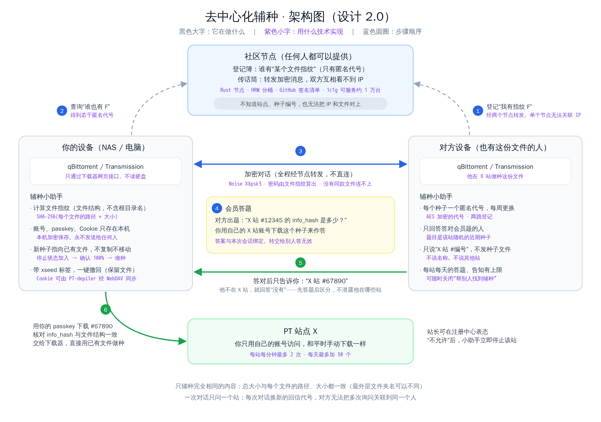

# 去中心化辅种（征求意见稿 2.0）

> 状态：已实现主要功能，准备公开测试。日期：2026-11-11。技术细节见[概要设计](../02-概要设计说明书.md)与[详细设计](../03-详细设计说明书.md)。

## 一句话

**有同一份文件的用户之间，答对“只有该站会员才答得上”的题，才互相告诉对方“这份文件在哪个站是几号种子”。没有任何服务器知道你有什么、在哪些站。**

> 矢量版：[去中心化辅种-架构图.svg](去中心化辅种-架构图.svg)

现在的 IYUU 等工具需要把你全部种子的信息交给一个中心服务器，它因此知道你在哪些站、硬盘里有什么。本方案中的社区节点只登记匿名的“文件指纹”、转发加密消息，不掌握任何站点资源目录。

## 怎么用

在 NAS 或电脑上运行“辅种小助手”（Docker 或 Windows 托盘程序），在网页里填好下载器地址就行：

1. 它读取 qBittorrent / Transmission 里**已 100% 完成**的种子，按 tracker 地址自动识别站点，passkey 从 tracker 地址中读出；需要 Cookie 的站点可以从 **PT-depiler** 自动同步；
2. 匿名登记“我有这些文件指纹”，并找出社区里有同款文件的人；
3. 向对方询问“这份文件在 X 站有没有”，**双方都是 X 站会员**并且答对会员题，对方才告诉你“X 站 #编号”；
4. 你的小助手**用你自己的账号**从 X 站下载这个种子，核对一致后交给下载器，直接用已有文件做种：**不复制、不移动、不删除、不重新下载**。

**只辅种完全相同的内容**：总大小、每个文件的路径和大小都一致（最外层文件夹名可以不同）。

所有新加入的种子都带 `xseed` 标签，可以在“辅种记录”里一键全部撤回，文件不受影响。

## 安全性

### 三道关

| 关 | 做法 | 挡住了谁 |
|---|---|---|
| ① 文件暗号 | 两台小助手之间的加密对话，密码由**文件结构算出**。不知道这份文件结构的人，对话建立不起来 | 没有这份文件的人 |
| ② 会员答题 | 对方从 X 站随机挑一个近期种子编号出题，你必须**用自己的 X 站账号**下载它、算出特征值作答。答案与本次对话绑定，找别人代答、转交答案都无效 | 没有 X 站账号的人 |
| ③ 只说一件事 | 答对后对方只说“X 站 #编号”，不发种子文件、不说名称、不提其他站；他不在 X 站时回答“没有”，而且是**先出题后区分**，问一问并不能知道他在不在 X 站 | 想顺便打听更多信息的人 |

### 逐个问题回答

| 担心 | 能不能做到 | 为什么 |
|---|---|---|
| 外人能不能拿到某站的资源列表？ | **不能** | 每次只能问“我手里这份文件”，没有文件过不了关①，没有账号过不了关②；即使都过了，得到的也只是你本来就能在站内搜到的编号 |
| 别人能不能知道我有哪些文件、在哪些站？ | **不能** | 每个种子用单独的匿名代号，每周更换；一次对话只问一个站；每次对话换新的回信地址，无法把多次询问拼到同一个人身上 |
| 别人能不能拿到我的 IP？ | **不能** | 所有消息都经社区节点转发，两台小助手从不直接连接；登记内容经两个节点转发并加密，单个节点无法把 IP 和你有什么文件联系起来 |
| 社区节点能不能偷看？ | **不能** | 对话的密码只在两台小助手上生成；节点转发的是乱码，只能看到匿名代号和随机编号 |
| 我的账号、passkey、Cookie 会不会被发出去？ | **不会** | 它们加密保存在你自己的设备上，只用于访问站点本身（下载地址只发往该站自己的域名）；发给对方的只有答案和编号 |
| 有人故意给假编号怎么办？ | **伤不到你** | 下载到的种子要核对特征值、文件结构、tracker 是否属于该站，对不上直接放弃；新种子先以停止状态加入，确认文件完整后才开始做种，绝不会往你的文件里写数据 |
| 会不会给站点添麻烦？ | **尽量不会** | 每站每分钟最多访问 2 次、每天最多加 50 个；启动时间随机错开 |
| 站点不想参与怎么办？ | **可以退出** | 站长在注册中心表态“不允许”，所有小助手收到新清单后立即停止在该站工作 |

### 做不到的地方（实话实说）

- **对方会知道你也有这份文件、也是 X 站会员**：这是辅种本身绕不开的，但只关联到匿名代号。
- **会员可以把账号借给外人代答**：答题只能证明“答题的人能用某个会员账号下载”，无法根除借号。
- **你连接的入口节点知道你的 IP**（但不知道你有什么文件、在和谁说话）。介意的话可以固定一个信任的节点，或自己搭一个。
- **入口节点与登记节点合谋**，可以把 IP 和“某个文件指纹”联系起来，但仍然不知道站点和编号。节点由不同的人运营，可以降低这种风险。
- **文件结构不是秘密**：知道某个公开发布的文件列表的人可以过关①，所以关②才是真正的门槛。

## 节点由谁提供

- **任何人都可以提供节点**：一台 1 核 1 GB 的服务器跑一个 Rust 程序，约可服务 1 万台在线设备。节点越多，每个节点承担的工作越少。
- **节点清单在 GitHub 上公开登记**，签名后发布；小助手只接受签名正确的清单，并拒绝版本回退。你也可以只用自己搭的节点。
- 部署方法见[发布与运维](../05-发布与运维.md)。

## 想听听你的意见

1. 安全性上还有哪些担心没有被回答？
2. 站长们，你们愿意让站点参与吗？在什么条件下愿意？
3. 每站每天最多加 50 个、每分钟访问 2 次，这个默认值合适吗？
4. 你愿意提供节点吗？你所在网络能否访问境外节点？

反馈地址：<https://github.com/aidever/xseed/issues>
